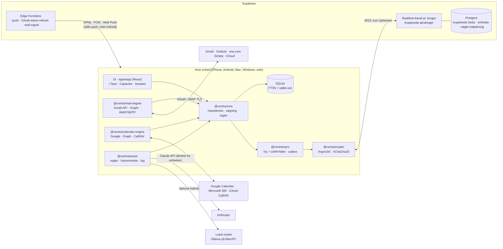

# CENTRA arkitektur

## Stack og hvorfor (5 linjer)

1. **Én React-kodebase (TypeScript + Vite) i alle skaller**: Tauri 2 på Mac og Windows, Capacitor på iPhone og Android, GitHub Pages på web. Det er samme UI og samme kode overalt.
2. **Hvorfor ikke React Native**: GSAP, Lenis og React Bits er DOM-biblioteker. I en web-baseret UI virker de alle steder, og Tauri/Capacitor giver native vinduer, menuer, haptics, push og auto-opdatering.
3. **Lokal database på hver enhed** (IndexedDB nu, SQLite med FTS5 og vektorsøgning fra trin 3). Alt læses lokalt, så søgning holder sig under 100 ms, og appen virker offline.
4. **Yjs (CRDT) til noternes tekst** og last-writer-wins pr. felt med hybride logiske ure til alt andet. To enheder kan skrive i samme note samtidig uden tab.
5. **libsodium end-to-end**: en nøgle afledes af din passphrase (Argon2id) og krypterer alt indhold (XChaCha20-Poly1305), før det forlader enheden. Serveren (relæ eller Supabase) gemmer kun ciphertext.

Ændret i trin 2: trin 1 foreslog Expo/React Native. Det blev skiftet ud, da GSAP, Lenis og React Bits kom med, fordi de kun virker i en DOM.

## Overblik



## Repo

```
apps/app            React + Vite: alle skærme, bevægelseslag, updater
apps/desktop        Tauri 2 (updater, process, single instance)
packages/design-system  tokens → CSS-variabler, ikoner, brand
packages/crypto     Argon2id, XChaCha20-Poly1305, nøgleindpakning, KeyRing
packages/sync       SyncEngine, HLC, relæ-klienter (WS, Supabase), IndexedDB-lager, konto
services/relay      relæ-server (Node + ws), kun ciphertext, Dockerfile
services/supabase   produktionsskema med RLS
```

Senere trin tilføjer `packages/mail-engine`, `packages/calendar-engine` og `packages/assist`.

## Bevægelse

- **GSAP** står for skærmskift (8 px løft og fade med 30 ms stagger), åbning af kommandopaletten (timeline), at godkendte og arkiverede rækker foldes sammen, Flip når en note fastgøres, nu-linjen der glider, og fremdriftsbjælker.
- **Lenis** giver blød, inerti-baseret scroll i note-editoren og mail-læseren. Listerne bruger native scroll (`data-lenis-prevent`).
- **React Bits**: DecryptedText på hilsenen og mens nøglen låses op, CountUp når et måltal ændres, ClickSpark ved Godkend og Log opdatering, og LightRays (prismets lys) kun på låseskærmen.
- Alt er 100–250 ms, kun transform og opacity, og slås fra med `prefers-reduced-motion`.

## Auto-opdatering

| Platform | Mekanisme | Kilde |
|---|---|---|
| Mac, Windows | Tauri updater: download, minisign-verifikation, installation, genstart | `releases/latest/download/latest.json` |
| iPhone, Android | @capgo/capacitor-updater skifter web-laget ud over luften. Native ændringer går via TestFlight og Play | `ota.json` + `centra-web-x.y.z.zip` |
| Web | GitHub Pages; `version.json` beder åbne faner om at genindlæse | Pages |

`npm run release` bumper versionen, tagger og pusher. `.github/workflows/release.yml` bygger og udgiver.

## Synk-kernen

- **Alt er en "entitet"** med `id` og `type`. Hvert felt har sin egen HLC-tidsstempel. Typerne er note, event, mail, person, goal, goalUpdate, suggestion, rule og memory.
- **Serveren ser kun konvolutter**: batch-id, enhed, nøgle-id og ciphertext. Entitets-id, type, feltnavne og værdier ligger alle inde i ciphertexten.
- **Noter** er et Yjs-dokument pr. note. Hver ændring er en lille Yjs-opdatering, der krypteres og sendes. Andre enheder fletter den ind. Samtidige ændringer på to enheder flettes på tegnniveau, så intet går tabt. Snapshots komprimeres hver 200. opdatering, og hvert snapshot er også en version i historikken.
- **Alt andet** (aftaler, mål, indstillinger) bruger last-writer-wins pr. felt. Hvis du ændrer titlen på mobilen og tidspunktet på Mac'en, holder begge ændringer.
- **Outbox**: alle ændringer skrives lokalt først og lægges i en outbox. Synk sender den, når der er net. UI'et venter aldrig på netværket.
- **Realtime**: én Supabase Realtime-kanal pr. bruger. Målet er under 1 sekund fra mobil til computer, og kravet er 2 sekunder. Testen ligger i `packages/sync/test/latency.test.ts` (trin 2).
- **Konflikttests**: fuzz-test med to til fem simulerede enheder, der redigerer offline og synker i tilfældig rækkefølge. Alle skal ende i samme tilstand.

## Konto, enheder og kryptering

- **Login** med e-mail-link eller passkey (WebAuthn). Supabase Auth bærer sessionen.
- **Hovednøgle** = Argon2id(passphrase, salt). Den forlader aldrig enheden og ligger i Keychain, Keystore eller platformens sikre lager.
- **Hver enhed** har sit eget nøglepar. En ny enhed godkendes enten med passphrasen eller ved at scanne en QR-kode fra en enhed, der allerede er logget ind.
- **Enhedslisten** i Indstillinger viser navn, sidst set og platform. "Log ud" tilbagekalder enhedens session og roterer indholdsnøglen.
- **Serveren ser kun** bruger-id, enheds-id, entitetstype, tidsstempler og ciphertext-størrelse.

## Indbakke-motoren og E2E

Fordi backend ikke må læse mail, henter **enhederne selv** mailen:

- **Gmail API og Microsoft Graph** via OAuth (PKCE). Refresh-tokens krypteres i din vault og synkes mellem dine enheder.
- **IMAP/SMTP** til one.com, Simply og iCloud. Mobil og desktop taler IMAP direkte. Web-versionen bruger et TLS-over-WebSocket-relæ, som kun ser krypterede bytes.
- **Push for vigtige mails**: Gmail og Graph sender et "ny mail"-signal (kun et id) til en Edge Function. Den sender en stille push til dine enheder. Enheden henter mailen, klassificerer den lokalt og viser selv notifikationen. For IMAP bruges IDLE på desktop og baggrundshentning på mobil.
- **Lokalt indeks**: al mailtekst indekseres krypteret i SQLite på enheden (FTS5 + embeddings), så søgning virker på tværs af konti og hele historikken uden server.
- **Tovejs**: læst, arkiv, slet, labels, flyt og stjerne skrives tilbage til udbyderen via en operations-kø med genforsøg. Fortryd-send holder mailen i 10 sekunder (kan ændres). Planlagt afsendelse kræver en enhed, der er online på tidspunktet. v1 bruger din desktop eller udbyderens egen planlagte afsendelse, hvor den findes (Gmail, Graph). Se roadmap.

## Kalender

- Providers: Google Calendar API, Microsoft Graph og CalDAV (iCloud). Tovejs-synk med sync-tokens og delta-links.
- Gentagelser via RRULE (rrule.js) med undtagelser. Tidszoner gemmes som IANA-zone pr. aftale.
- Naturligt sprog ("frokost med Mads fredag 12") parses af en lokal dansk/engelsk parser først. Assist bruges kun som fallback.
- "Find tid" og fokusblokke bruger dine ledige tider og dine lærte vaner fra Assist-hukommelsen.

## Mål

- **Tre typer**: *tal-mål* (værdi mod et mål, fx 412 af 500 km), *milepæle* (trin, der kan krydses af) og *vaner* (antal gange pr. uge).
- **Opdateringer** er sine egne entiteter (`goal-update`) med tid, ændring (+5,2 km eller et trin), fritekst og kilde (dig selv, en note, en aftale eller et godkendt Assist-forslag). Status og fremdrift beregnes altid ud fra opdateringerne og gemmes aldrig separat.
- **"På sporet"** beregnes ud fra det tempo, der kræves for at nå målet inden fristen, sammenlignet med dit faktiske tempo.
- **Kobling**: et mål kan kobles til aftaler (fx gentagne løbeture), noter og mails. Assist foreslår opdateringer ud fra disse, og du godkender dem.
- **Ugentligt check-in** (søndag aften, hvis Assist har lært det): et kort overblik over hvert mål med ét felt pr. mål.

## CENTRA Assist

- **Én service** i `@centra/assist`. Alle kald går gennem en router, der vælger model:
  - **Claude** (Anthropic API, kaldt direkte fra enheden med din egen nøgle) til briefing, udkast og resuméer.
  - **Lokal model** (Ollama på din Mac/PC) til indhold, du markerer som følsomt, og til mails fra kontakter på en "kun lokalt"-liste.
- **Rate-limit** pr. dag og pr. funktion. Hvert kald logges lokalt med tid, funktion, model, tokens og hvilke kilder der blev sendt. Loggen kan ses under Indstillinger → Assist-log.
- **Hukommelse** er strukturerede regler, ikke magi:
  - Tabellen `memory` indeholder: `kind` (rutine, person, skrivestil, mail-vane, mødetid, projekt), `statement`, `evidence` (de handlinger der førte til reglen), `confidence`, `source` (handling eller du fortalte det) og `editable`.
  - Panelet "Det ved CENTRA om dig" viser hver regel med dens beviser. Du kan rette eller slette alt.
- **Læring kun fra handlinger**: arkivér, svar, flyt, ignorér, godkend og afvis. Plus det, du eksplicit fortæller den. Ingen gætteri ud fra indhold alene.
- **Forslag, aldrig handlinger**: alt Assist vil gøre bliver et `suggestion` med Godkend/Afvis. Automatik findes kun som regler, du selv har slået til ("arkivér altid Politiken Morgen"). Det håndhæves i `core` og testes: ingen mutation uden et godkendt forslag eller en aktiv regel.
- **RAG**: chat på tværs af noter, mails, kalender og mål med lokal retrieval (FTS5 + vektorer). Kun de fundne uddrag sendes til modellen, og svaret viser kildehenvisninger.
- **Friktionslog**: gentagne manuelle handlinger og søgninger uden resultat bliver til "Forslag til CENTRA", som du kan godkende som regel eller som opgave i backloggen.

## Ydelsesbudget

| Mål | Hvordan |
|---|---|
| Koldstart < 1,5 s | Lokal snapshot læses før netværket; tunge dele (WebGL, krypto) indlæses kun hvor de bruges |
| Søgning < 100 ms | FTS5 lokalt, embeddings forberegnet i baggrunden |
| 60 fps | GSAP på transform og opacity; Lenis kører på GSAP's ticker |
| Synk ≤ 2 s | Realtime-WSS, små krypterede deltaer, outbox |
